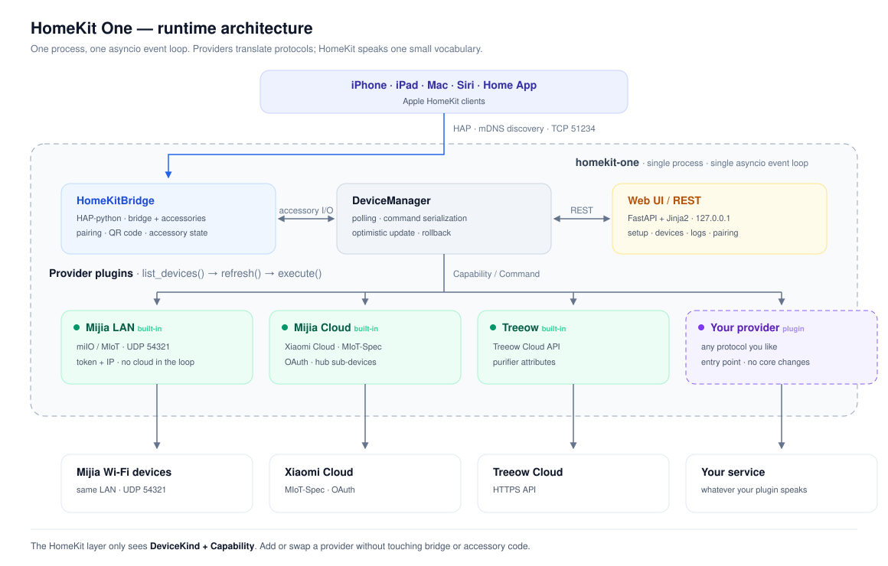
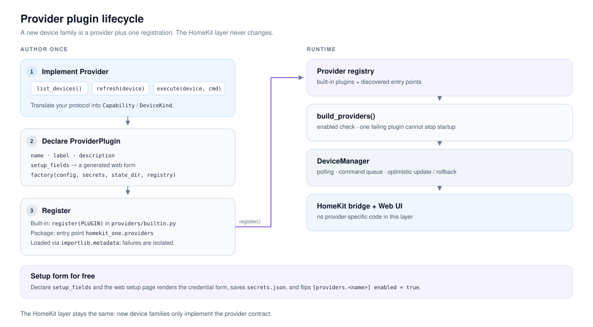
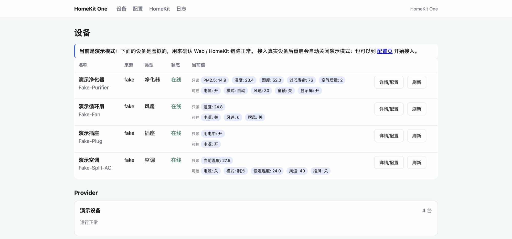

# HomeKit One

**English** · [简体中文](README.zh-CN.md)


HomeKit One is a local-first **HomeKit gateway for macOS**. It brings Mijia (Xiaomi) Wi-Fi devices, Mijia cloud devices and Treeow air purifiers into Apple Home, Siri and Shortcuts — through a **provider plugin architecture** where a new brand is a drop-in module, not a fork.



## Why HomeKit One

- **Plugins, not hard-coded integrations.** Mijia LAN, Mijia Cloud and Treeow ship as provider plugins. Any Python package can add another brand through an entry point — no changes to the HomeKit layer.
- **Local first.** Mijia LAN traffic never leaves your network. Cloud providers are opt-in, per account.
- **Guided web setup.** Sign in, verify credentials, pick devices, restart and scan the pairing code. No TOML required for normal use.
- **One small vocabulary.** Providers expose `DeviceKind` + `Capability`; the HomeKit layer maps that vocabulary to HAP services once.
- **Real HomeKit services.** AC → `HeaterCooler`, purifier → `AirPurifier` + `AirQualitySensor`, lamp → `Lightbulb`. Categories HomeKit does not model degrade to `Switch`, `Valve` or `Sensor` instead of disappearing.
- **Runs unattended.** launchd installer, automatic restart, a stable pairing code and `0600` secrets.
- **Single process.** HAP, polling, cloud clients and the web UI share one asyncio event loop.

## Architecture

HomeKit One has four layers:

| Layer | Responsibility |
| --- | --- |
| `HomeKitBridge` | HAP-python bridge. Publishes one accessory per device, handles pairing and pushes changed characteristics to the Home app. |
| `DeviceManager` | Lists devices from every provider, polls them with per-device backoff, serializes commands per device, applies optimistic updates and rolls back on failure. |
| Provider plugins | Translate a vendor protocol into `Device` / `Capability` and execute commands. This is the only place brand-specific code lives. |
| Web UI / REST | FastAPI + Jinja2 setup wizard, device pages, logs, pairing page and a JSON API on `127.0.0.1:8080`. |

The important boundary is between `DeviceManager` and the providers: the HomeKit layer never imports a vendor client and never sees a vendor payload. It only reads `Device.state` and writes `Command(capability, value)`.

Accessories are built at startup. Adding or removing devices takes a restart; the launchd service does that automatically, and the web UI offers a restart button.

## Provider plugins

A provider implements three required methods and two optional lifecycle hooks:

```python
class Provider(ABC):
    async def start(self) -> None: ...                              # optional
    async def stop(self) -> None: ...                               # optional
    async def list_devices(self) -> list[Device]: ...
    async def refresh(self, device: Device) -> dict[Capability, Any]: ...
    async def execute(self, device: Device, command: Command) -> None: ...
```

A plugin adds metadata, an optional generated setup form and a factory:

```python
from homekit_one.providers.plugins import ProviderPlugin, SetupField, register

register(
    ProviderPlugin(
        name="my_provider",
        label="My brand",
        description="Cloud devices from My brand.",
        setup_fields=(
            SetupField("username", "Account", required=True),
            SetupField("password", "Password", secret=True, required=True),
        ),
        factory=build_provider,  # (config, secrets, state_dir, registry) -> Provider
    )
)
```

There are two ways to register a plugin:

- **Built-in:** call `register(...)` from `src/homekit_one/providers/builtin.py`.
- **External package:** publish an entry point. It is discovered with `importlib.metadata`, and one broken plugin cannot stop startup.

```toml
[project.entry-points."homekit_one.providers"]
my_provider = "my_package.plugin:PLUGIN"
```

`SetupField` entries become a credential form on the web setup page. Saving it writes the values to `secrets.json` and flips `[providers.my_provider] enabled = true`, so a plugin gets onboarding, verification and allow-list selection without writing any UI code.



The full contract, including `ProviderError` / `AuthError` handling and raw `provider_data` access, is in [docs/plugins.md](docs/plugins.md) (Chinese).

### Built-in providers

| Plugin | Transport | Notes |
| --- | --- | --- |
| `mijia` | LAN miIO / MIoT over UDP 54321 | Four static models, token + IP, no cloud in the control path. |
| `mijia_cloud` | Xiaomi Cloud `miotspec` | OAuth, hub sub-devices and extra categories; internet required. |
| `treeow` | Treeow Cloud API | Air purifiers; internet required. |
| `fake` | In-process demo | Four virtual devices; enabled automatically when no real provider is configured. |

### Supported devices

Mijia LAN has explicit attribute maps for:

| Model | Type | Capabilities |
| --- | --- | --- |
| `zhimi.airpurifier.rma1` | Purifier | Power, auto/manual, fan speed, PM2.5, temperature, humidity, filter life, child lock, display |
| `dmaker.fan.p28` | Fan | Power, fan speed 1–100, swing, temperature, humidity, child lock, display |
| `chuangmi.plug.m3` | Plug | Power, outlet in use, temperature, display |
| `yeelink.light.lamp4` | Light | Power, brightness, color temperature 2600–5000 K |

Mijia Cloud identifies devices from their MIoT-Spec URN, so it covers lights, plugs, switches, purifiers, fans, ACs, thermostats, temperature/humidity/PM2.5 sensors, cameras, vacuums, pet feeders, pet waterers and speakers without a per-model table. Multi-button switches expose the first button; curtains, dehumidifiers, motion/door sensors and body scales are not supported yet. Treeow exposes power, auto/manual/strong/sleep modes, seven fan levels, PM2.5, formaldehyde/VOC, temperature, humidity, filter life, UV, anion, buzzer, smart mode, night mode, child lock, display and filter reset.

### HomeKit mapping

| Device / feature | HomeKit service | Notes |
| --- | --- | --- |
| AC | `HeaterCooler` | Mode, target temperature, fan speed, swing |
| Purifier | `AirPurifier` + `AirQualitySensor` + `FilterMaintenance` | Plus linked temperature/humidity sensors |
| Fan | `Fanv2` | Power, fan speed, swing |
| Light | `Lightbulb` | Power, brightness, color temperature |
| Plug | `Outlet` | Power, outlet in use |
| Thermostat / heated blanket | `Thermostat` | Target and current temperature |
| TV | `Television` + `TelevisionSpeaker` + `InputSource` | Power, volume, mute, inputs |
| Speaker | `Speaker` + `Switch` | Volume, mute; switch for play/pause |
| Camera | `Switch` + `MotionSensor` | No video stream |
| Vacuum | `Switch` + `BatteryService` + `FilterMaintenance` | Switch = start cleaning / stop and dock |
| Pet feeder | `Switch` | On dispenses one portion |
| Pet waterer | `Valve` + `BatteryService` + `FilterMaintenance` | On = continuous flow, off = auto |
| Dishwasher | `Switch` | On = start / stop wash |
| UV, anion, display, etc. | `Switch` | Separate accessory so each has a readable name |
| Body scale | Not supported | No readable weight attribute |

`extra_switches = "minimal"` (the default) keeps HomeKit to native services and readings; extra switches are exposed only for lights and thermostats. Set it to `auto`, `all` or `none` in the config, or use the device detail page in the web UI.

## Quick start

Requirements: macOS 15+ (tested on macOS 27 / Apple Silicon), Python 3.11+ (3.12 recommended) and [uv](https://docs.astral.sh/uv/).

```bash
# from the repository root
uv venv --python 3.12
uv pip install -e ".[dev]"

# Demo: four virtual devices, web UI and HomeKit bridge
.venv/bin/homekit-one run

# Or start and open the setup wizard
.venv/bin/homekit-one setup
```

Then:

1. Open <http://127.0.0.1:8080/setup>.
2. Pick a provider and save its credentials. The page logs in immediately, lists the devices it can see and lets you choose which ones to expose.
3. Click **Restart** when the page says the configuration changed.
4. Open **HomeKit** and scan the pairing QR code with the iPhone **Home** app.

No hardware yet? `run` without a config starts four demo devices so you can test the Home app, web UI and pairing flow. Once a real provider is enabled, demo mode turns itself off.



*The web dashboard in demo mode. The UI is currently Chinese.*

## Configuration

Use the web setup page for normal operation; it writes credentials to `secrets.json` and enables the matching provider. `config.example.toml` is for allow-lists, poll intervals and other advanced options. The default paths are:

| Path | Contents |
| --- | --- |
| `~/.config/homekit-one/config.toml` | Gateway and provider configuration |
| `~/Library/Application Support/HomeKit One/secrets.json` | Mijia tokens, Treeow password, Xiaomi OAuth token (`0600`) |
| `.../devices.json` | Mijia devices added in the web UI (`0600`) |
| `.../accessory.state` | HomeKit pairing keys; delete it to reset pairing |
| `.../pairing.json` | Stable pairing code (`0600`) |

Credentials are resolved in this order: **environment variables → `secrets.json` → `config.toml`**. The most useful variables are `HOMEKIT_ONE_CONFIG`, `HOMEKIT_ONE_MIJIA_CLOUD_USERNAME` / `_PASSWORD`, `HOMEKIT_ONE_TREOW_ACCOUNT` / `_PASSWORD`, and `HOMEKIT_ONE_MIJIA_TOKEN_<DEVICE_ID>`. A minimal advanced configuration looks like this:

```toml
[gateway]
web_port = 8080
homekit_port = 51234
extra_switches = "minimal"
# homekit_pincode = "031-45-678"   # otherwise generated and persisted
# homekit_address = "192.168.1.20" # otherwise the physical LAN address is detected

[providers.mijia]
enabled = true
poll_interval = 5

[[providers.mijia.devices]]
id = "0x12345678"
name = "Living room purifier"
model = "zhimi.airpurifier.rma1"
host = "192.168.1.20"
# Prefer secrets.json or HOMEKIT_ONE_MIJIA_TOKEN_0X12345678 over a token here.

[providers.mijia_cloud]
enabled = true
country = "cn"

[providers.treeow]
enabled = false
```

### Xiaomi OAuth

Xiaomi has restricted password login, so the recommended path is OAuth:

1. On the setup page, choose the account region and click **Xiaomi OAuth**.
2. Sign in and approve; the browser redirects to `http://homeassistant.local:8123`, which will not load — that is expected.
3. Copy the full callback URL from the address bar and paste it back into the setup page.

The page verifies the token immediately and lists the account's devices. The authorization page may show the application name “Xiaomi Home (Home Assistant Integration)” — HomeKit One reuses the public OAuth client published by XiaoMi/ha_xiaomi_home. The token is stored only in `secrets.json`; the CLI equivalents are `homekit-one mijia-oauth-login` and `homekit-one mijia-cloud-list`.

> Upgrading from the old `homeone` name? The old `~/.config/homeone` and `~/Library/Application Support/HomeOne` paths, and the `HOMEONE_CONFIG` / `HONE_*` environment variables, are still honored when the new paths do not exist.

## CLI

The web UI covers normal setup. The CLI is for scripts, diagnostics and headless machines.

| Command | Purpose |
| --- | --- |
| `homekit-one run` | Start the gateway (`--no-homekit` for web only). |
| `homekit-one setup` | Start and open the setup page. |
| `homekit-one discover` | Broadcast for Mijia devices on the LAN. |
| `homekit-one mijia-oauth-login` | Authorize a Xiaomi account in the browser. |
| `homekit-one mijia-import --oauth` | Import LAN tokens using the saved OAuth grant. |
| `homekit-one mijia-cloud-list` | List cloud devices; `--specs --props --actions` for diagnosis. |
| `homekit-one treeow-list` | Log in to Treeow and show raw + mapped attributes. |
| `homekit-one pairing` | Print the pairing code and setup URI. |
| `homekit-one doctor` | Check config, ports, state permissions and credentials; `--probe` logs in to each provider. |

Run `homekit-one <command> --help` for every option.

## HomeKit notes

- The pairing code is random on first start, stored in `pairing.json`, and stable across restarts. Set `gateway.homekit_pincode` to choose one.
- The bridge advertises the physical LAN address by default, avoiding VPN/utun interfaces. Override it with `gateway.homekit_address` if the Mac has several networks.
- Reset pairing by deleting `accessory.state` or using the button on the **HomeKit** page.
- Remote access needs a HomePod, HomePod mini or Apple TV as a home hub; the Mac must stay awake.
- If the Home app shows every accessory as unresponsive after a network or structure change, quit and reopen the app, restart the home hub, then remove and re-pair the bridge if needed.

## Run as a service

```bash
./scripts/install.sh                                              # venv, dependencies, LaunchAgent, start
launchctl kickstart -k gui/$(id -u)/com.homekitone.gateway        # restart
./scripts/sync-local-runtime.sh                                   # copy edited code to the runtime and restart
./scripts/uninstall.sh                                            # stop and remove
tail -f ~/Library/Logs/homekit-one.log
```

`install.sh` copies the venv and package to `~/Library/Application Support/HomeKitOne/runtime` when the repository lives on an external volume, because launchd cannot read some `/Volumes/...` paths without TCC permission.

On first use, run `homekit-one run` once in a terminal and allow the macOS **Local Network** prompt. A launchd process that is denied local-network access will not be discoverable by the Home app.

## Development

```bash
.venv/bin/pytest -q
.venv/bin/ruff check src tests
```

```text
src/homekit_one/
  app.py              process wiring: providers → manager → HomeKit + web
  cli.py              run / setup / discover / OAuth / pairing / doctor
  config.py           TOML loading and validation
  secrets.py          0600 secrets store
  core/model.py       Capability, DeviceKind, Device, Command
  core/manager.py     polling, command queue, optimistic updates
  providers/base.py   the Provider contract
  providers/plugins.py  plugin registry and entry-point loading
  providers/builtin.py  built-in plugin declarations
  providers/mijia/      LAN miIO client, crypto, discovery, model maps
  providers/mijia_cloud/ OAuth, device list, MIoT-Spec parsing
  providers/treeow/     Treeow login and attribute mapping
  homekit/            HAP bridge and capability → service mapping
  web/                FastAPI app and Jinja2 templates
```

Tests cover miIO crypto and discovery, model maps, MIoT-Spec parsing, cloud property access, Treeow mapping, config validation, the device manager, HomeKit service construction and the web API.

## Known limits

1. **Cloud providers need the internet.** Treeow has no public LAN protocol, and Mijia cloud devices (including hub sub-devices) depend on Xiaomi Cloud.
2. **The accessory set is fixed at startup.** Add or remove devices, then restart. The launchd service restarts automatically.
3. **Mijia LAN supports four static models.** Other Wi-Fi devices go through Mijia Cloud; BLE/Zigbee devices need a hub online.
4. **Some cloud categories are degraded.** Cameras expose power and motion but no stream, vacuums and pet appliances are switch-level, and body scales are unsupported.
5. **HAP-python is not an MFi-certified implementation.** Pairing and control work, but Apple certification is not claimed.
6. **The web UI binds to `127.0.0.1` by default.** Binding it to `0.0.0.0` gives anyone on the LAN access to account credentials and device control.

## Credits and license

Original code is MIT licensed. Thanks to these MIT projects:

- [iPocket-APP/MijiaLAN](https://github.com/iPocket-APP/MijiaLAN) — miIO framing, discovery and capability mapping ideas.
- [hlhk2017/treeow-homeassistant](https://github.com/hlhk2017/treeow-homeassistant) — Treeow login and property access.
- [ikalchev/HAP-python](https://github.com/ikalchev/HAP-python) — the HAP server.
- [Squachen/micloud](https://github.com/Squachen/micloud) — Xiaomi cloud token import.

HomeKit One is not affiliated with Xiaomi, Treeow or Apple, and is not HomeKit / MFi certified.
