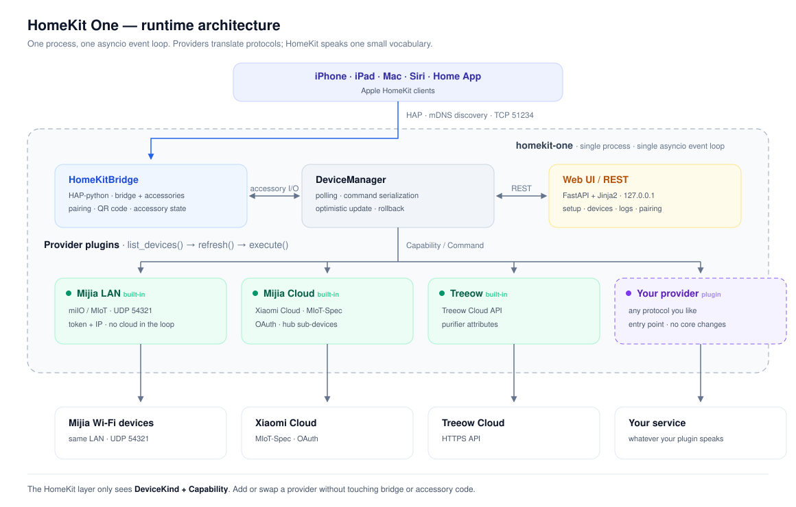
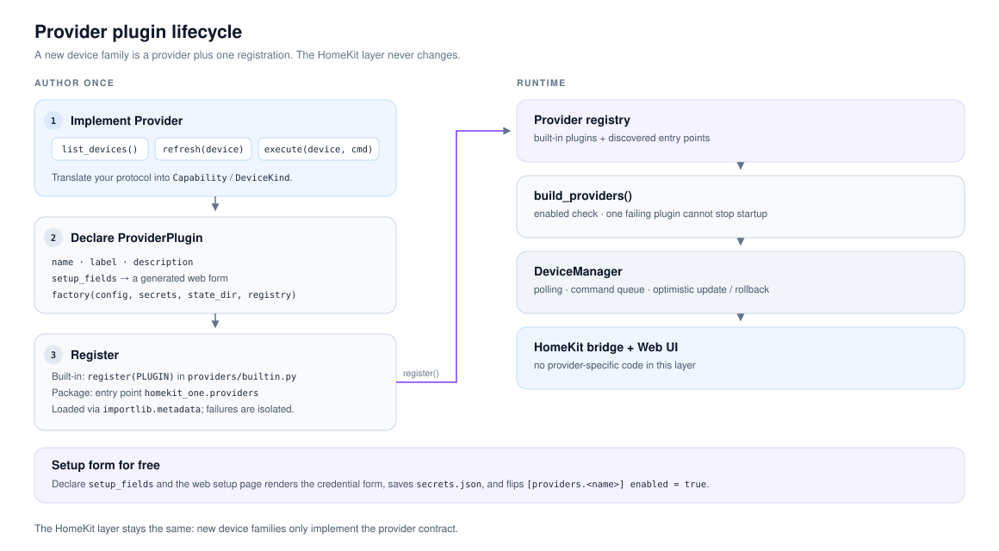
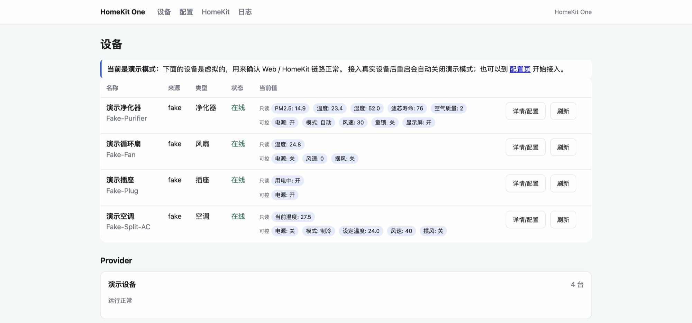

# HomeKit One

[English](README.md) · **简体中文**


HomeKit One 是一个在 macOS 上常驻运行的**本地优先 HomeKit 网关**。它把米家（小米）Wi-Fi 设备、米家云端设备和树新风 Treeow 净化器接入 Apple「家庭」、Siri 和快捷指令。核心是一套**Provider 插件架构**：新增一个品牌只需要加一个插件，而不是 fork 整个项目。



## 为什么是 HomeKit One

- **插件化，而不是写死集成。** 米家局域网、米家云和 Treeow 都是 provider 插件。任何 Python 包都可以通过入口点增加新品牌，HomeKit 层不需要改动。
- **本地优先。** 米家局域网流量不离开你的网络；云 provider 按账号逐个开启。
- **网页接入向导。** 登录、验证凭据、选择设备、重启、扫码配对，日常使用不需要手写 TOML。
- **一套很小的词汇表。** Provider 只暴露 `DeviceKind` + `Capability`，HomeKit 层只做一次映射。
- **原生 HomeKit 服务。** 空调 → `HeaterCooler`，净化器 → `AirPurifier` + `AirQualitySensor`，台灯 → `Lightbulb`。HomeKit 没有对应服务的品类会降级成 `Switch`、`Valve` 或 `Sensor`，而不是直接消失。
- **无人值守。** launchd 安装脚本、自动重启、稳定的配对码，凭据文件权限 `0600`。
- **单进程。** HAP、轮询、云客户端和 Web UI 共用一个 asyncio 事件循环。

## 架构

HomeKit One 分为四层：

| 层 | 职责 |
| --- | --- |
| `HomeKitBridge` | HAP-python 桥接器。每台设备发布一个配件，处理配对，并把变化推送给「家庭」App。 |
| `DeviceManager` | 从所有 provider 拉取设备列表，按设备轮询并做退避，串行化命令，先乐观更新、失败后回滚。 |
| Provider 插件 | 把厂商协议翻译成 `Device` / `Capability` 并执行命令。品牌相关代码只存在于这一层。 |
| Web UI / REST | FastAPI + Jinja2 接入向导、设备页、日志页、配对页，以及 `127.0.0.1:8080` 上的 JSON API。 |

最关键的边界在 `DeviceManager` 和 provider 之间：HomeKit 层从不 import 厂商客户端，也看不到厂商原始报文，它只读取 `Device.state`、写入 `Command(capability, value)`。

配件在启动时构建。新增或删除设备后需要重启；launchd 服务会自动拉起，Web 页面也提供重启按钮。

## Provider 插件

Provider 实现三个必需方法，外加两个可选生命周期钩子：

```python
class Provider(ABC):
    async def start(self) -> None: ...                              # 可选
    async def stop(self) -> None: ...                               # 可选
    async def list_devices(self) -> list[Device]: ...
    async def refresh(self, device: Device) -> dict[Capability, Any]: ...
    async def execute(self, device: Device, command: Command) -> None: ...
```

插件再补上元数据、可选的自动表单和工厂函数：

```python
from homekit_one.providers.plugins import ProviderPlugin, SetupField, register

register(
    ProviderPlugin(
        name="my_provider",
        label="我的品牌",
        description="接入示例品牌的云端设备。",
        setup_fields=(
            SetupField("username", "账号", required=True),
            SetupField("password", "密码", secret=True, required=True),
        ),
        factory=build_provider,  # (config, secrets, state_dir, registry) -> Provider
    )
)
```

注册方式有两种：

- **内置插件：** 在 `src/homekit_one/providers/builtin.py` 里调用 `register(...)`。
- **外部包：** 发布一个入口点，`importlib.metadata` 会发现它；单个插件加载失败不会阻断启动。

```toml
[project.entry-points."homekit_one.providers"]
my_provider = "my_package.plugin:PLUGIN"
```

`SetupField` 会变成 Web 配置页上的凭据表单。保存后字段写入 `secrets.json`，并自动把 `[providers.my_provider] enabled` 改为 `true`。也就是说，插件不用写任何 UI 代码就能获得接入、验证和设备白名单选择能力。



完整契约（包括 `ProviderError` / `AuthError` 处理和读取原始 `provider_data`）见 [docs/plugins.md](docs/plugins.md)。

### 内置 Provider

| 插件 | 传输方式 | 说明 |
| --- | --- | --- |
| `mijia` | 局域网 miIO / MIoT，UDP 54321 | 四个静态型号，token + IP，控制链路不依赖云。 |
| `mijia_cloud` | 小米云 `miotspec` | OAuth、中枢子设备和更多品类；需要外网。 |
| `treeow` | Treeow 云 API | 净化器；需要外网。 |
| `fake` | 进程内演示 | 四台虚拟设备；没有配置真实 provider 时自动启用。 |

### 支持的设备

米家局域网有明确的属性表：

| 型号 | 类型 | 暴露能力 |
| --- | --- | --- |
| `zhimi.airpurifier.rma1` | 净化器 | 开关、自动/手动、风速、PM2.5、温度、湿度、滤芯、童锁、显示屏 |
| `dmaker.fan.p28` | 循环扇 | 开关、风速 1–100、摆风、温度、湿度、童锁、显示屏 |
| `chuangmi.plug.m3` | 插座 | 开关、用电状态、温度、显示屏 |
| `yeelink.light.lamp4` | 灯 | 开关、亮度、色温 2600–5000 K |

米家云根据设备的 MIoT-Spec URN 自动识别属性，因此不需要逐型号维护属性表，覆盖灯、插座、开关、净化器、风扇、空调、温控、温湿度/PM2.5 传感器、摄像头、扫地机、宠物喂食器、宠物饮水机和音箱。多键开关只接第一个按键；窗帘、除湿机、人体/门窗传感器和体脂秤暂不支持。Treeow 暴露开关、自动/手动/极净/睡眠、风速 7 档、PM2.5、甲醛/VOC、室温、湿度、滤芯寿命、UV、负离子、提示音、智能托管、夜间智能、童锁、显示屏和滤芯复位。

### HomeKit 服务映射

| 设备 / 功能 | HomeKit service | 说明 |
| --- | --- | --- |
| 空调 | `HeaterCooler` | 模式、目标温度、风速、摆风 |
| 净化器 | `AirPurifier` + `AirQualitySensor` + `FilterMaintenance` | 另链接温度/湿度传感器 |
| 风扇 | `Fanv2` | 开关、风速、摆风 |
| 灯 | `Lightbulb` | 开关、亮度、色温 |
| 插座 | `Outlet` | 开关、用电状态 |
| 温控 / 水暖毯 | `Thermostat` | 目标温度、当前温度 |
| 电视 | `Television` + `TelevisionSpeaker` + `InputSource` | 电源、音量、静音、信源 |
| 音箱 | `Speaker` + `Switch` | 音量、静音；开关做播放/暂停 |
| 摄像头 | `Switch` + `MotionSensor` | 不含视频流 |
| 扫地机 | `Switch` + `BatteryService` + `FilterMaintenance` | 开关 = 开始清扫 / 停止回充 |
| 宠物喂食器 | `Switch` | 打开 = 出粮一份 |
| 宠物饮水机 | `Valve` + `BatteryService` + `FilterMaintenance` | 开 = 恒定出水，关 = 自动模式 |
| 洗碗机 | `Switch` | 开 = 开始 / 停止洗涤 |
| UV、负离子、显示屏等 | `Switch` | 独立配件，保证每个开关有可读名称 |
| 体脂秤 | — | 没有可读的重量属性 |

`extra_switches = "minimal"`（默认）让 HomeKit 只保留原生服务和只读参数，所有额外开关（包括水暖毯、扫地机的设置）都不进 Home App，统一在 Web 设备详情页配置；`auto` 会为设备暴露少量常用开关，`all` 暴露全部，`none` 与 minimal 相同（全部关闭）。

## 快速开始

要求：macOS 15+（已在 macOS 27 / Apple Silicon 验证）、Python 3.11+（推荐 3.12）和 [uv](https://docs.astral.sh/uv/)。

```bash
# 在仓库根目录执行
uv venv --python 3.12
uv pip install -e ".[dev]"

# 演示模式：四台虚拟设备 + Web UI + HomeKit 桥接
.venv/bin/homekit-one run

# 或者直接启动并打开接入向导
.venv/bin/homekit-one setup
```

然后：

1. 打开 <http://127.0.0.1:8080/setup>。
2. 选择品牌并保存凭据。页面会立即登录、列出可接入设备，并允许勾选要暴露的设备。
3. 页面提示配置已变更后，点「重启网关」。
4. 打开「HomeKit」页，用 iPhone「家庭」App 扫描配对二维码。

还没有真实设备？不带配置运行 `run` 会启动四台演示设备，用来验证「家庭」App、Web 和配对链路。启用真实 provider 后演示模式会自动关闭。



*演示模式下的 Web 设备页。*

## 配置

日常接入使用 Web 配置页即可，它会把凭据写入 `secrets.json` 并自动启用对应 provider。`config.example.toml` 适合需要白名单、轮询间隔等高级选项的场景。默认路径：

| 路径 | 内容 |
| --- | --- |
| `~/.config/homekit-one/config.toml` | 网关和 provider 配置 |
| `~/Library/Application Support/HomeKit One/secrets.json` | 米家 token、Treeow 密码、小米 OAuth token（`0600`） |
| `.../devices.json` | Web UI 添加的米家设备（`0600`） |
| `.../accessory.state` | HomeKit 配对密钥；删除后需要重新配对 |
| `.../pairing.json` | 稳定的配对码（`0600`） |

凭据优先级：**环境变量 → `secrets.json` → `config.toml`**。常用变量有 `HOMEKIT_ONE_CONFIG`、`HOMEKIT_ONE_MIJIA_CLOUD_USERNAME` / `_PASSWORD`、`HOMEKIT_ONE_TREOW_ACCOUNT` / `_PASSWORD` 和 `HOMEKIT_ONE_MIJIA_TOKEN_<DEVICE_ID>`。一个最小的高级配置示例：

```toml
[gateway]
web_port = 8080
homekit_port = 51234
extra_switches = "minimal"
# homekit_pincode = "031-45-678"   # 不填则自动生成并持久化
# homekit_address = "192.168.1.20" # 不填则自动检测物理局域网地址

[providers.mijia]
enabled = true
poll_interval = 5

[[providers.mijia.devices]]
id = "0x12345678"
name = "客厅净化器"
model = "zhimi.airpurifier.rma1"
host = "192.168.1.20"
# token 建议放在 secrets.json 或 HOMEKIT_ONE_MIJIA_TOKEN_0X12345678 中。

[providers.mijia_cloud]
enabled = true
country = "cn"

[providers.treeow]
enabled = false
```

### 小米 OAuth

小米已限制旧版密码登录，推荐使用 OAuth：

1. 在配置页选择账号区域，点「小米 OAuth 授权」。
2. 登录并授权；浏览器会跳转到 `http://homeassistant.local:8123`，这个页面打不开是正常的。
3. 从地址栏复制完整回调 URL，粘贴回配置页。

页面会立即验证 token 并列出账号下的设备。授权页显示的应用名可能是 “Xiaomi Home (Home Assistant Integration)”，这是复用 XiaoMi/ha_xiaomi_home 公开 OAuth client 的正常现象。token 只保存在本机 `secrets.json`。对应的终端命令是 `homekit-one mijia-oauth-login` 和 `homekit-one mijia-cloud-list`。

> 从旧版 `homeone` 升级？如果新路径不存在，程序会继续使用旧的 `~/.config/homeone`、`~/Library/Application Support/HomeOne`，以及 `HOMEONE_CONFIG` / `HONE_*` 环境变量。

## 命令行

日常接入用 Web 页面即可。命令行适合脚本、排障和无浏览器环境。

| 命令 | 用途 |
| --- | --- |
| `homekit-one run` | 启动网关（`--no-homekit` 只启动 Web）。 |
| `homekit-one setup` | 启动并打开接入配置页。 |
| `homekit-one discover` | 广播发现局域网米家设备。 |
| `homekit-one mijia-oauth-login` | 在浏览器里完成小米账号授权。 |
| `homekit-one mijia-import --oauth` | 用已保存的 OAuth 授权导入局域网 token。 |
| `homekit-one mijia-cloud-list` | 列出云端设备；`--specs --props --actions` 用于诊断。 |
| `homekit-one treeow-list` | 登录 Treeow，显示原始字段和映射结果。 |
| `homekit-one pairing` | 显示配对码和 setup URI。 |
| `homekit-one doctor` | 检查配置、端口、状态目录权限和凭据；`--probe` 会实际登录每个 provider。 |

所有选项见 `homekit-one <command> --help`。

## HomeKit 说明

- 配对码首次启动时随机生成并写入 `pairing.json`，重启后保持不变。可以在 `gateway.homekit_pincode` 里固定。
- 桥接器默认广播物理局域网地址，避开 VPN/utun 网段。Mac 有多个网络时可用 `gateway.homekit_address` 显式指定。
- 删除 `accessory.state` 或在「HomeKit」页点重置按钮即可清除配对。
- 外网访问需要 HomePod、HomePod mini 或 Apple TV 作为家居中枢，且 Mac 不能休眠。
- 如果网络或配件结构变化后「家庭」App 全部显示无响应：先完全退出并重开 App，重启家居中枢；仍不恢复时删除桥接并重新扫码配对。

## launchd 常驻

```bash
./scripts/install.sh                                              # 创建 venv、安装依赖、写入 LaunchAgent、启动
launchctl kickstart -k gui/$(id -u)/com.homekitone.gateway        # 重启
./scripts/sync-local-runtime.sh                                   # 同步修改后的代码并重启
./scripts/uninstall.sh                                            # 停止并移除
tail -f ~/Library/Logs/homekit-one.log
```

当仓库位于外置磁盘 `/Volumes/...` 时，`install.sh` 会把 venv 和包复制到 `~/Library/Application Support/HomeKitOne/runtime`，因为 launchd 没有该磁盘的 TCC 权限，Python 可能在启动阶段卡住。

首次运行建议先在终端前台执行一次 `homekit-one run`，允许 macOS 的「本地网络」权限弹窗。launchd 后台进程如果被拒绝本地网络访问，「家庭」App 会搜不到网关。

## 开发

```bash
.venv/bin/pytest -q
.venv/bin/ruff check src tests
```

```text
src/homekit_one/
  app.py             进程编排：providers → manager → HomeKit + Web
  cli.py             run / setup / discover / OAuth / pairing / doctor
  config.py          TOML 加载和校验
  secrets.py         0600 凭据存储
  core/model.py      Capability、DeviceKind、Device、Command
  core/manager.py    轮询、命令队列、乐观更新
  providers/base.py  Provider 契约
  providers/plugins.py  插件注册表和入口点加载
  providers/builtin.py  内置插件声明
  providers/mijia/      局域网 miIO 客户端、加密、发现、型号映射
  providers/mijia_cloud/ OAuth、设备列表、MIoT-Spec 解析
  providers/treeow/     Treeow 登录和属性映射
  homekit/           HAP 桥接和能力 → 服务映射
  web/               FastAPI 应用和 Jinja2 模板
```

测试覆盖 miIO 加解密与发现、型号映射、MIoT-Spec 解析、云属性读写、Treeow 映射、配置校验、DeviceManager、HomeKit 服务构建和 Web API。

提交规范见 [CONTRIBUTING.md](CONTRIBUTING.md)。

## 已知边界

1. **云 provider 依赖外网。** Treeow 没有公开局域网协议；米家云设备（包括中枢子设备）依赖小米云。
2. **配件集在启动时固定。** 增删设备后需要重启；launchd 服务会自动拉起。
3. **米家局域网只支持四个静态型号。** 其他 Wi-Fi 设备走米家云；BLE/Zigbee 设备需要中枢在线。
4. **部分云品类是降级映射。** 摄像头只有开关和移动侦测、没有视频流；扫地机和宠物设备是开关级控制；体脂秤不支持。
5. **HAP-python 不是 MFi 认证实现。** 配对和控制可用，但不宣称通过 Apple 认证。
6. **Web UI 默认只监听 `127.0.0.1`。** 改成 `0.0.0.0` 等于把账号凭据和设备控制权限开放给整个局域网。

## 致谢与许可

原创代码使用 MIT License。参考项目（均为 MIT）：

- [iPocket-APP/MijiaLAN](https://github.com/iPocket-APP/MijiaLAN) — miIO 报文格式、发现流程和能力映射思路。
- [hlhk2017/treeow-homeassistant](https://github.com/hlhk2017/treeow-homeassistant) — Treeow 登录和设备属性读写。
- [ikalchev/HAP-python](https://github.com/ikalchev/HAP-python) — HAP 服务端。
- [Squachen/micloud](https://github.com/Squachen/micloud) — 小米云 token 导入。

本项目与小米、树新风、Apple 均无隶属关系，也未获得 HomeKit / MFi 认证。
